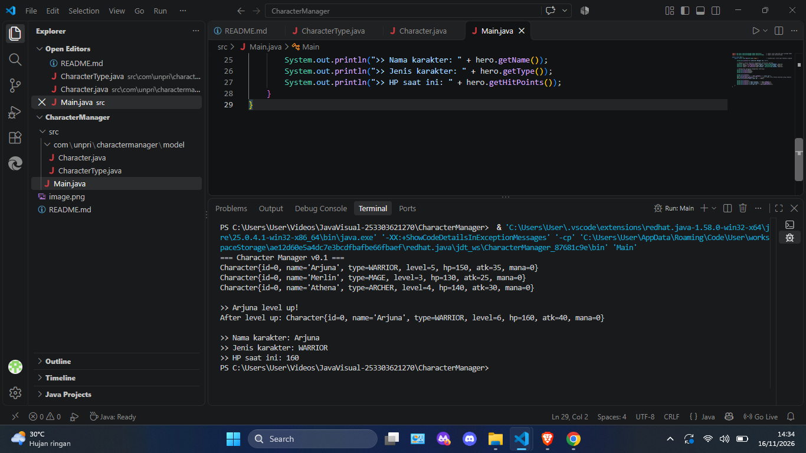

# Character Manager — TP3 (Java Visual SIH-6406)
Proyek ini adalah fondasi model class untuk aplikasi Character Manager berbasis Java 17. Berisi enum CharacterType dan class Character dengan dua constructor, validasi pada setter, serta fitur tambahan mana dan isAlive(). Class ini akan menjadi dasar GUI pada sprint berikutnya.

## Output Terminal


## Struktur Folder
```
CharacterManager/
│
├── src/
│   ├── com/
│   │   └── unpri/
│   │       └── charactermanager/
│   │           └── model/
│   │               ├── Character.java
│   │               └── CharacterType.java
│   │
│   └── Main.java
│
├── output.png
└── README.md
```

## Identitas
Nama: Louren kristin br brahmana 
NIM: 253303621270

Analisis Bagian D (Google Docs): https://drive.google.com/file/d/1a5pzSZgiHmdTFMs5o29KIncLWAodGXss/view?usp=drivesdk